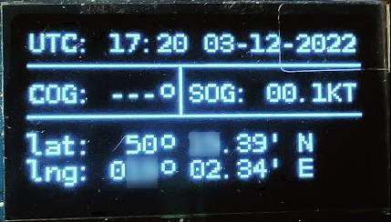
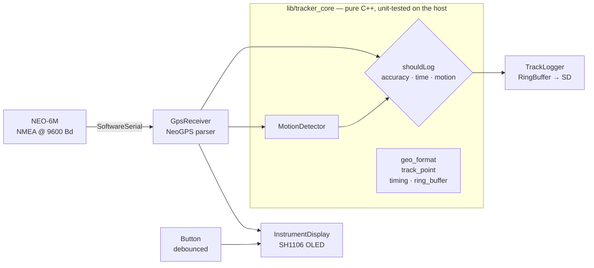
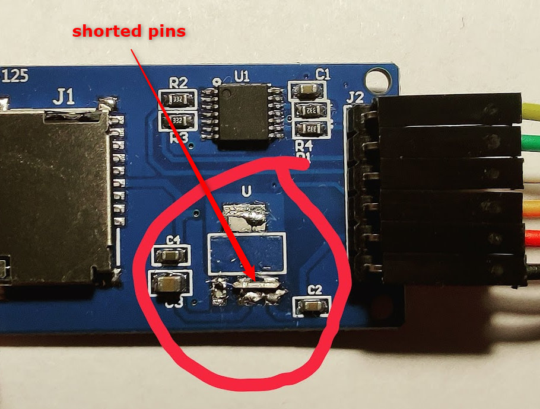

# Sea Logger — GPS track logger for sailors

[](https://github.com/ekonovember/sea-logger/actions/workflows/ci.yml)


[](LICENSE)

A pocket-size, battery-powered GNSS logger built from a handful of hobby parts: a
**u-blox NEO-6M** receiver, a **NodeMCU (ESP8266)**, a 128×64 OLED and a micro-SD card.
It shows time, position, course and speed like a chart-plotter repeater, and records
the track to the SD card **only when the fix is accurate enough and the yacht is
actually moving** — so a week at sea produces a clean track, not a cloud of anchor
jitter. A small Python tool turns the logs into GPX for OpenCPN, Navionics, QGIS or
Google Earth.

<p align="center">
  <br>
  <sub>The first version on the bench, December 2022 (position partly masked).</sub>
</p>

> **An old project — the idea and the first version date from 2022.** Today a phone app,
> a chart-plotter or a modern multi-band receiver does this out of the box (see
> [How I would build it today](#how-i-would-build-it-today)).

## Features

- **Accuracy-gated logging.** The receiver is switched on to emit the NMEA **GST**
  sentence (pseudorange error statistics); a point is stored only when the mean 1σ
  latitude/longitude error is within a threshold (15 m by default).
- **Movement detection with hysteresis.** Logging starts after 6 s of continuously
  reported course and speed and stops after 3 s without — a single noisy fix or a
  boat swinging at anchor does not start a track.
- **Chart notation on screen.** WGS-84 position in degrees and decimal minutes
  (`50° 15.23' N`), course over ground, speed in knots, UTC time; a ring shows the
  current error in metres, three concentric rings mean "recording".
- **Kind to the SD card and the battery.** Points are buffered in a fixed-size RAM
  ring buffer and appended once a minute to one CSV file per UTC day; the display
  can be switched off with the button.
- **Robust files.** ISO 8601 UTC timestamps, a header line, midnight roll-over
  handled, a failed write is retried rather than losing the buffer.
- **CSV → GPX converter** (`tools/csv_to_gpx.py`, standard library only) that merges
  days, sorts, de-duplicates and still reads the 2022 log format.

## Architecture



| Layer | Where | What |
|---|---|---|
| **Core** | `lib/tracker_core/` | All decisions and formatting: coordinate conversion with correct rounding, logging policy, motion hysteresis, debouncing, interval timers, CSV/file-name format, ring buffer. No Arduino headers, time is injected — so it runs in `pio test -e native` on any PC. |
| **Drivers** | `src/gps_receiver.*`, `src/instrument_display.*`, `src/track_logger.*` | Thin adapters over NeoGPS, the SH1106 driver and the SD library, translating to core types. |
| **App** | `src/main.cpp` | Wiring only. Non-blocking loop: one fix per second from the GPS, every other job on its own timer. |
| **Config** | `include/config.h` | Pins, thresholds and intervals in one place, as `constexpr`. |
| **Build** | `platformio.ini`, `tools/apply_neogps_config.py` | NeoGPS is configured by `#define`s inside the library; a pre-build script applies them to the downloaded copy, idempotently, and fails loudly if a NeoGPS update moves them. |

## Hardware

| Part | Notes |
|---|---|
| NodeMCU v3 (ESP8266) | any ESP8266 dev board with the same pin labels |
| u-blox NEO-6M module + patch antenna | 9600 Bd factory default |
| SH1106 128×64 I²C OLED | an SSD1306 works too: swap `SH1106Wire` for `SSD1306Wire` |
| HW-125 micro-SD module | 5 V module — see the modification below |
| push button + 10 kΩ resistor | display on/off |
| USB power bank + micro-USB cable (with data lines) | power, and flashing |

### Wiring

| NEO-6M | NodeMCU | | SH1106 | NodeMCU | | HW-125 | NodeMCU |
|---|---|---|---|---|---|---|---|
| VCC | 3V3 | | VDD | 3V3 | | VCC | 3V3 |
| GND | G | | GND | G | | GND | G |
| TX | D3 | | SCK | D1 | | CS | D8 |
| RX | D4 | | SDA | D2 | | SCK | D5 |
| | | | | | | MOSI | D7 |
| | | | | | | MISO | D6 |

Button: one leg to **3V3**, the other to **D0**, with the 10 kΩ resistor from D0 to **G**
(pull-down).

### HW-125 modification

The HW-125 carries a 5 V → 3.3 V regulator that will not run from the NodeMCU's 3.3 V
rail. Remove the regulator and bridge the marked pads so the card is powered directly:

<p align="center">
  
</p>

## Build, test, flash

Requires [PlatformIO](https://platformio.org/) (CLI or the VS Code extension).

```bash
pio test -e native                  # core unit tests on your PC
pio run  -e nodemcuv2               # build the firmware
pio run  -e nodemcuv2 -t upload     # flash over USB
pio device monitor                  # serial log (set kSerialDebug = true in config.h)
```

Libraries are fetched automatically on the first build; NeoGPS is configured by the
pre-build script, nothing to edit by hand.

## Configuration

Everything lives in [`include/config.h`](include/config.h):

| Setting | Default | Meaning |
|---|---|---|
| `kRequireMovement` | `true` | log only while under way; `false` logs every accurate fix (bench testing) |
| `kMaxPositionErrorM` | `15` m | maximum mean 1σ horizontal error of a logged point |
| `kMotionStartMs` / `kMotionStopMs` | 6 s / 3 s | movement hysteresis |
| `kLogIntervalMs` | 3 s | track point interval (~28 800 points per day at sea) |
| `kSdFlushIntervalMs` | 60 s | how often the RAM buffer is written to the card |
| `kSerialDebug` | `false` | print every fix to the serial monitor |

## Log format and GPX export

One file per UTC day, e.g. `2026-11-01.csv`:

```csv
time_utc,latitude,longitude,sog_kn,cog_deg
2026-11-01T10:00:00Z,50.253700,19.034400,5.1,121.0
2026-11-01T10:00:03Z,50.253800,19.034500,5.3,123.0
```

Copy the card's files to a folder and convert:

```bash
python tools/csv_to_gpx.py /media/sd track.gpx
python tools/csv_to_gpx.py 2026-11-01.csv 2026-11-02.csv -o leg1.gpx --name "Leg 1"
```

## Tests

| Suite | Runs | Covers |
|---|---|---|
| `test/test_core` (Unity) | `pio test -e native` | coordinate rounding and carry (59.999′ → next degree), fixed-width screen strings, speed/course formatting, motion hysteresis incl. `millis()` wrap-around, debouncing, logging policy, CSV and file names, ring buffer |
| `tools/tests` (unittest) | `python -m unittest discover -s tools/tests` | both log formats, sorting, de-duplication, truncated last line, GPX 1.1 output |

Both run in GitHub Actions together with the firmware build.

## Working with an AI agent

The repository is set up for [Claude Code](https://claude.com/claude-code):
[`CLAUDE.md`](CLAUDE.md) holds the architecture rules (no Arduino headers in the core,
time injected, no heap in the loop), commands and hardware notes, and `.claude/` adds
scoped permissions (flashing always asks) and `/test`, `/flash` and `/gpx` commands.

## How I would build it today

The 2022 constraints were "parts from the drawer, no app, no subscription". With the
same goal today I would choose:

- **Receiver:** a multi-band, multi-constellation module (u-blox **M10** for low power, or
  **ZED-F9P** for RTK-grade work) instead of the single-band GPS-only NEO-6M; for
  centimetre accuracy, RTK corrections from an NTRIP caster or a local base station.
- **Protocol:** u-blox **UBX** binary messages (`NAV-PVT`, with `hAcc`) instead of NMEA +
  GST — one message per epoch, an explicit horizontal-accuracy estimate, no parsing of
  six sentences.
- **MCU:** an **ESP32-S3/C3** with BLE to stream NMEA to OpenCPN or a phone, and deep sleep
  between fixes; LittleFS or an SD card with a journaling-friendly write pattern.
- **Output:** GPX or GeoJSON written directly on the device.

## History

| Version | Date | What |
|---|---|---|
| **v1.0** | December 2022 | First working logger, built over a few weeks from November 2022: display, button, SD logging, GST-based accuracy gate, CSV parsers. Tag [`v1.0`](../../tree/v1.0). |
| **v2.0** | November 2026 | Refactored into a tested, hardware-independent core with thin drivers; fixed coordinate rounding; fixed-size ring buffer instead of a heap list; automated NeoGPS configuration; one file per UTC day with ISO 8601 times; standard-library GPX converter; CI. Tag [`v2.0`](../../tree/v2.0). |

## License

[MIT](LICENSE) © Maciej Welchar. Libraries keep their own licenses — notably
[NeoGPS](https://github.com/SlashDevin/NeoGPS) (GPL-3.0), which is downloaded at build
time and not redistributed here.
